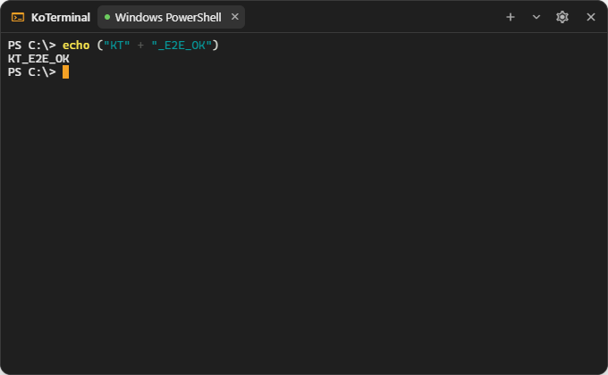

# KoTerminal

A real terminal in a [KoBar](https://github.com/Kobar-Project/KoBar) panel: tabs, PowerShell, Command Prompt, Git Bash,
WSL, zsh or bash, with colours, resizing and scrollback.



KoBar plugins run in KoBar's window and cannot start programs. KoTerminal therefore has two parts:

| Part | What it is |
|---|---|
| **Plugin** (`manifest.json`, `dist/index.js`) | The panel, built with [xterm.js](https://xtermjs.org). It is installed into KoBar. |
| **Bridge** (`bridge/`) | A small Node.js program that runs your shells with [node-pty](https://github.com/microsoft/node-pty). It listens only on `127.0.0.1` and accepts only connections that present your pairing token. |

## Requirements

- KoBar 1.4.0 or newer (Windows; macOS when KoBar's macOS build is released).
- [Node.js](https://nodejs.org) 20 or newer for the bridge. node-pty ships prebuilt binaries for Windows and macOS, so no
  compiler is needed there. Linux needs build tools (`python3`, `make`, `g++`).

## Setup

1. **Get KoTerminal and install the bridge**

   ```bash
   git clone https://github.com/eedali/KoTerminal.git
   cd KoTerminal/bridge
   npm install
   npm start
   ```

   On the first start the bridge prints a **pairing token**. Show it again later with `npm run token`.

2. **Install the plugin in KoBar.** Use either:
   - Settings > Plugins > *More install options* (⋯) > *Install from GitHub (Advanced)…*, with
     `https://github.com/eedali/KoTerminal`, or
   - *Install from file…* with the `KoTerminal-<version>.zip` from the
     [releases](https://github.com/eedali/KoTerminal/releases) page.

   KoBar asks you to confirm and shows an "unverified plugin" warning, because KoTerminal is not an official KoBar plugin.

3. **Pair them.** Settings > Plugins > Installed > KoTerminal > tune icon:
   - paste the token;
   - press *Test connection*.

4. **Use it.** Click the terminal icon on the bar.

### Start the bridge automatically (Windows)

```bash
cd KoTerminal/bridge
npm run autostart:install
```

This puts a small script in your Startup folder that starts the bridge hidden at login. Undo it with
`npm run autostart:remove`. You can also run `bridge/start-hidden.vbs` once by hand. If you pick that file in the
KoTerminal settings (*Bridge launcher*), the panel gets a *Start bridge* button.

On macOS, add `node /path/to/KoTerminal/bridge/src/cli.js` to your login items, or run `npm start` when you need it.

## Using KoTerminal

| Action | How |
|---|---|
| New terminal | `+` in the panel header, or Ctrl+Shift+T in a terminal |
| New terminal with another shell | the arrow next to `+` |
| Close a terminal | × on its tab, or Ctrl+Shift+W |
| Copy | select text, then Ctrl+C (Ctrl+C without a selection still interrupts the program) or Ctrl+Shift+C |
| Paste | Ctrl+V |
| Restart a shell that exited | press Enter in its tab |
| Move the panel along the bar | drag the panel header, or Alt+Arrow keys (KoBar feature) |

Terminals keep running while the panel is closed and come back with their output when you open it again. Closing a
tab ends its shell. When KoTerminal is disabled or removed in KoBar, all of its shells are closed within about ten seconds.

**Settings:**
- pairing token and bridge port (default `47011`);
- default shell;
- font size;
- panel size (small 520×320, medium 680×420, large 880×540);
- blinking cursor;
- scrollback;
- bridge launcher.

Languages: English and Turkish; KoBar's other languages fall back to English.

## Security

**Read [SECURITY.md](SECURITY.md) before you install.** In short:
- the bridge runs commands as you, so the pairing token is as sensitive as a password;
- without the token nobody can open a terminal;
- the bridge listens only on `127.0.0.1`, and its `Host` and `Origin` checks turn away web pages before they reach the
  login step;
- any other KoBar plugin can read KoTerminal's settings, including the token, because KoBar plugins are not isolated
  from each other. Install only plugins you trust.

Rotate the token with `npm run rotate-token` in `bridge/`.

## Bridge reference

```text
npm start                     start the bridge (node src/cli.js)
npm run token                 print the pairing token
npm run rotate-token          create a new token (pair KoTerminal again)
npm run autostart:install     Windows: start hidden at login
npm run autostart:remove      Windows: undo it
node src/cli.js --port 48000  use another port for this run
```

The configuration file (`bridge.json`: token, port, `allowedOrigins`, `maxSessions`) is stored in:

| System | Location |
|---|---|
| Windows | `%LOCALAPPDATA%\KoTerminal\` |
| macOS | `~/Library/Application Support/KoTerminal/` |
| Linux | `~/.config/koterminal/` |

**KoBar from source.** A KoBar development build (`npm run dev`) loads from `http://localhost:5173`, which the bridge
refuses by default. To allow it:
1. Add `"allowedOrigins": ["http://localhost:5173"]` to `bridge.json`.
2. Restart the bridge.

To see which `Origin` a connection sends, start the bridge with `KOTERMINAL_LOG_ORIGINS=1`.

### Protocol (version 1)

There is one WebSocket connection per terminal, to `ws://127.0.0.1:<port>/v1/terminal`. All frames are JSON text.

1. The first frame must be `{ type: 'auth', token }`, sent within 5 seconds. The bridge answers with `ready`, which
   lists the available shells by id and name (never their paths).
2. The client then sends `open` with an optional shell id and the terminal size.
3. After that, `input`/`output`, `resize`, `exit`, `ping`/`pong` and `error` frames follow.

Clients cannot name an executable; they can only pick a shell from the list. See
[bridge/src/protocol.js](bridge/src/protocol.js).

## Development

```bash
npm install                      # plugin build and test tools
npm --prefix bridge install      # bridge dependencies
npm run check                    # build dist/index.js, run the plugin tests and the bridge tests
npm run package                  # release/KoTerminal-<version>.zip for a GitHub release
```

- **Code layout:**
  - `src/` holds the plugin: `index.jsx` (registrations), `manager.js` (sessions outside React), `TerminalPanel.jsx`,
    `SettingsPanel.jsx`, `terminal.js` (xterm), `config.js`, `i18n.js` and `styles.js`.
  - `build.mjs` bundles it into one IIFE file that uses KoBar's `window.React`.
  - `dist/index.js` is committed, so installing from GitHub also works without a release asset.
- **End-to-end check in a real KoBar:**

  ```bash
  node scripts/e2e-kobar.mjs --kobar /path/to/KoBar
  ```

  It needs a built KoBar checkout. It starts a bridge on a test port and launches KoBar with a temporary profile, so
  your own profile is never used. It then runs a command, checks tabs and that terminals survive reopening the panel, and
  saves screenshots.
- **Testing inside KoBar while you edit:**
  1. Copy or link the repository into KoBar's git-ignored `pluginsPlayground/` folder.
  2. Allow the dev origin in `bridge.json` (see above).
  3. Run KoBar with `npm run dev`.

  There the plugin id becomes `dev-com.eedali.koterminal`. KoTerminal reads its id at run time, so its settings work
  there too.

## Licence

[MIT](LICENSE) © 2026 Ekrem EDALI. xterm.js and node-pty are MIT licensed.
